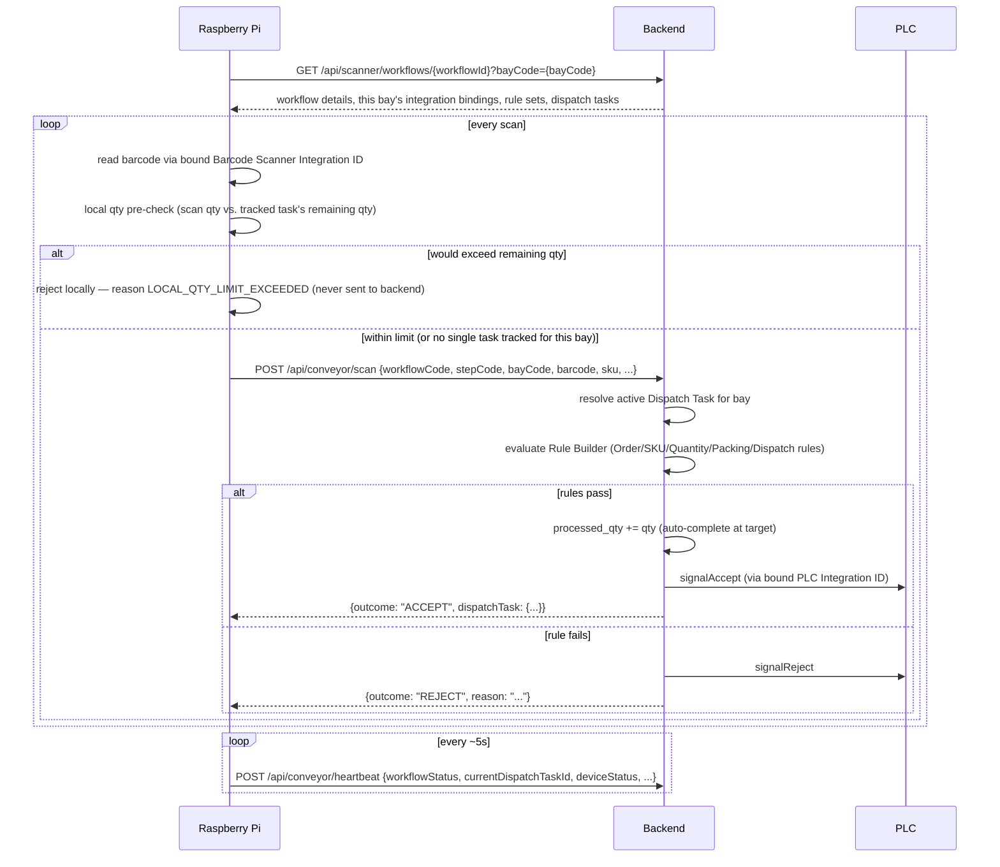

# Conveyor Scanner Workflow — Integration Guide

Backend reference for the Raspberry Pi / Python integration service driving a conveyor line: how it fetches its config, how a barcode scan is validated and answered, and exactly how dispatch-task quantity tracking and auto-completion work.

Built on the real workflow engine (`com.aria.workflow`) and the M11 Integration Hub (`com.aria.integration`) — package `com.aria.conveyor`. This is a **separate system** from the older `ConveyorAgentController` (`/api/m11/conveyor/...`, `m11_agent*` tables) — do not mix the two.

A reference Python client implementing everything in this guide lives at [`raspberry-pi-client/conveyor_client.py`](raspberry-pi-client/conveyor_client.py) (config in `raspberry-pi-client/config.example.json`).

## 1. Actors

| Actor | Role |
|---|---|
| Raspberry Pi (Python) | Per conveyor line. Fetches workflow config, reads the barcode scanner, calls the backend, drives the PLC. Contains **no hardcoded line-specific logic** — everything comes from config. |
| Backend | Resolves Integration IDs, runs the Rule Builder, tracks dispatch-task quantity, tells the device ACCEPT or REJECT. |
| Barcode Scanner | An `IntegrationInstance` (any connector) bound to a workflow step with role `BARCODE_SCANNER`. |
| PLC | An `IntegrationInstance` using connector `MODBUS_TCP`, bound with role `PLC`. Receives `signalAccept`/`signalReject`. |
| MQTT Broker (optional) | An `IntegrationInstance` using connector `MQTT_CONVEYOR`, anticipated as binding role `MQTT_BROKER` (see `WorkflowIntegrationBindingService` javadoc) though nothing currently resolves that role by name — see §9. Lets a device talk to the backend over MQTT instead of the HTTP endpoints in §2/§3. |

## 2. End-to-end flow



1. **Fetch config** — Pi calls `GET /api/scanner/workflows/{workflowId}?bayCode={bayCode}` once (and again whenever it needs to re-sync) to learn which Integration IDs handle which role at which step, its loading bay, the rule sets in force, and its current dispatch task(s) — scoped to its own bay.
2. **Read barcode** — via the Integration ID bound to role `BARCODE_SCANNER` for the current step/bay.
3. **Resolve SKU + local qty pre-check** — before calling `/api/conveyor/scan`, the Pi resolves the barcode's SKU (`GET /api/conveyor/skumaster`), fetches that SKU's live task (`GET /api/conveyor/dispatchdetails`), and compares the scan's quantity against its remaining quantity (`target_qty - processed_qty`); see §3.6. Any check failing rejects the scan on the device and never sends it over the network.
4. **Submit scan** — `POST /api/conveyor/scan`. The backend, not the device, evaluates every rule — the device never runs rule logic.
5. **Accept** → dispatch task's `processed_qty` increments (auto-completing at `target_qty`), PLC gets `signalAccept`.
6. **Reject** → PLC gets `signalReject`, reason recorded.
7. **Heartbeat** — `POST /api/conveyor/heartbeat` roughly every 5 seconds regardless of scan activity.

## 3. API Reference

### 3.1 `GET /api/scanner/workflows/{workflowId}`

`{workflowId}` is the workflow **code** (string, e.g. `M12.ConveyorTest`) — the same code used everywhere else in the workflow engine, resolved tenant-fork-first then global-latest-published.

**Request:** just the path. No auth header — `/api/scanner/workflows/**` and `/api/conveyor/**` are permit-all, since a conveyor device has no interactive login.

Optional query param **`?bayCode=BAY1`** scopes `integrations`, `plcIntegrations`, `loadingBays`, and `dispatchTasks` down to that one bay — everything else in the response (`workflowDetails`, `ruleBuilder`) stays workflow-level/unscoped, since those aren't bay-specific. Omit it to get every bay's data (the pre-existing behavior). A Pi client only cares about its own bay, so `conveyor_client.py` always passes its configured `bayCode`.

**Response** (verified live example):
```json
{
  "workflowId": "M12.ConveyorTest",
  "workflowCode": "M12.ConveyorTest",
  "workflowVersion": 1,
  "workflowStatus": "PUBLISHED",
  "workflowDetails": {
    "initialState": "SCANNING",
    "transitions": [{"from": "SCANNING", "to": "DONE", "pageCode": ""}]
  },
  "integrations": [
    {"step_code": "SCANNING", "bay_code": "BAY1", "integration_role": "BARCODE_SCANNER", "integration_id": 10, "config_overrides_json": null},
    {"step_code": "SCANNING", "bay_code": "BAY1", "integration_role": "PLC", "integration_id": 11, "config_overrides_json": null}
  ],
  "loadingBays": [],
  "ruleBuilder": [
    {"id": 1, "code": "RS-TEST", "version": 1, "name": "Test Rule Set", "status": "PUBLISHED"}
  ],
  "plcIntegrations": [
    {"step_code": "SCANNING", "bay_code": "BAY1", "integration_role": "PLC", "integration_id": 11, "config_overrides_json": null}
  ],
  "dispatchTasks": [
    {"id": 1, "workflow_code": "M12.ConveyorTest", "bay_code": "BAY1", "task_code": "TASK-TEST-1",
     "order_ref": "ORDER-1", "sku_code": "SKU-1", "vehicle_no": "TN01AB1234", "gp_number": "GP-2026-0042",
     "target_qty": 3.000, "processed_qty": 0.000,
     "rejected_qty": 0.000, "status": "Open", "rule_set_id": 1, "started_at": "...", "completed_at": null}
  ]
}
```

**Field notes:**
- `integrations` — every `workflow_integration_binding` row for this workflow. `integration_id` is an `IntegrationInstance.id` — fetch its connector-specific config separately if the device needs it (e.g. barcode scanner serial config), or via `config_overrides_json` on the binding itself.
- `ruleBuilder` — rule set **metadata only** (code/name/status), never the rule expressions. Rules run exclusively on the backend.
- `dispatchTasks` — every task for the workflow, any status. Filter client-side for `status = "Open"` to find what's currently active.

`404` if the workflow code doesn't resolve to a PUBLISHED definition.

### 3.2 `POST /api/conveyor/scan`

**Request:**
```json
{
  "workflowCode": "M12.ConveyorTest",
  "stepCode": "SCANNING",
  "bayCode": "BAY1",
  "barcode": "BC-001",
  "taskId": null,
  "scannerIntegrationId": 10,
  "sku": "SKU-1",
  "orderRef": "ORDER-1",
  "qty": null
}
```

| Field | Required | Notes |
|---|---|---|
| `workflowCode` | yes | |
| `bayCode` | yes | Which bay this scan happened at — used to resolve the active Dispatch Task and the PLC binding. |
| `barcode` | yes | The raw scanned value. |
| `stepCode` | recommended | Used to resolve the `PLC` integration binding for THIS step (a line can use a different PLC at different steps). |
| `taskId` | optional | Force a specific Dispatch Task. If omitted, the bay's single active task is used automatically; if several tasks are concurrently active on the bay, the one whose **resolved** SKU (see below)/`orderRef` matches wins. |
| `scannerIntegrationId` | optional | Recorded on the scan log for traceability. |
| `sku` | **ignored** | Not read anywhere — see the SKU resolution note below. Still accepted on the wire (older clients may still send it) but has no effect. |
| `orderRef` | optional | Whatever the label/scan actually encodes — fed into Rule Builder evaluation and, on accept, stamped onto the scan log. |
| `qty` | optional | Defaults to `1`. Supports multi-unit scans (e.g. a case barcode worth 12 units). Checked client-side against the tracked task's remaining qty before this request is even sent — see §3.6. |

**SKU resolution (server-side, never trusted from the device):** before any Dispatch Task
lookup or Rule Builder evaluation, the backend resolves the *authoritative* SKU by looking
up `barcode` against `m5_sku_master` — `WHERE tenant_id = ? AND (barcode = ? OR sku_code = ?)`
(matches either column, since some scanner configurations emit the SKU code directly rather
than the printed barcode; ties broken by `id` — `barcode` isn't a unique key). This resolved
SKU, not the request's own `sku` field, is what `scannedSku` in the Rule Builder context
(§5) and `matched_sku` in `dispatch_task_scan_log` actually are. Two REJECT outcomes happen
here, before a Dispatch Task is even looked up:
```json
{ "outcome": "REJECT", "reason": "UNKNOWN_BARCODE", "dispatchTask": null, "plcSignalOk": null }
```
```json
{ "outcome": "REJECT", "reason": "SKU_INACTIVE", "dispatchTask": null, "plcSignalOk": null }
```
`UNKNOWN_BARCODE` — no `m5_sku_master` row matches at all. `SKU_INACTIVE` — a row matched but
its `status` isn't `ACTIVE` (discontinued/blocked). Same convention as the older
`ConveyorAgentController`'s equivalent lookup (`com.aria.integration.conveyor`) — a different
system, but the same physical problem (a barcode that isn't a known, active SKU should never
reach rule evaluation).

**Response — ACCEPT** (verified live):
```json
{
  "outcome": "ACCEPT",
  "reason": null,
  "dispatchTask": {
    "id": 1, "target_qty": 3.000, "processed_qty": 1.000, "rejected_qty": 0.000,
    "status": "Open", "completed_at": null, "...": "..."
  },
  "plcSignalOk": true
}
```

**Response — REJECT** (verified live, SKU mismatch):
```json
{
  "outcome": "REJECT",
  "reason": "SKU_MISMATCH",
  "dispatchTask": { "...": "unchanged except rejected_qty and updated_at" },
  "plcSignalOk": true
}
```

**Response — no active task** (e.g. task already completed, or none started):
```json
{ "outcome": "REJECT", "reason": "NO_ACTIVE_TASK", "dispatchTask": null, "plcSignalOk": null }
```

`plcSignalOk` reflects whether the bound PLC integration's `signalAccept`/`signalReject` call succeeded (`true`/`false`), or `null` if no PLC is bound for this step/bay at all.

### 3.3 `POST /api/conveyor/heartbeat`

**Request:**
```json
{
  "workflowCode": "M12.ConveyorTest",
  "deviceId": "PI-BAY1",
  "workflowStatus": "RUNNING",
  "currentDispatchTaskId": 1,
  "deviceStatus": "ONLINE",
  "lastScanAt": "2026-07-24T06:16:22Z",
  "integrationHealth": {"scanner1-test": "OK", "plc1-test": "OK"}
}
```
Send roughly every 5 seconds. `(workflowCode, deviceId)` is the upsert key. A device that stops heartbeating is automatically flipped to `device_status = "OFFLINE"` after ~15 seconds by a background sweep (`DeviceHeartbeatStalenessScheduler`).

**Response:** `{"ok": true}`

### 3.4 `GET /api/conveyor/skumaster?barcode=...`

Tokenless (same `/api/conveyor/**` permit-all convention). Lets the device resolve a scanned
barcode to its SKU **before** deciding whether to even call `/api/conveyor/scan` — the same
resolution `POST /api/conveyor/scan` runs server-side as its own authoritative check
(`SkuMasterLookupService`, §3.2), exposed here for the device's own local pre-check (§3.6) to
use. Matches on either `barcode` or `sku_code` on `m5_sku_master`, same as the server-side
check.

**Response — found, active:**
```json
{"found": true, "skuCode": "SKU1463", "skuDescription": "...", "boxQty": 12, "status": "ACTIVE"}
```
**Response — found, inactive:**
```json
{"found": true, "skuCode": "SKU9999", "skuDescription": "...", "boxQty": 12, "status": "DISCONTINUED"}
```
**Response — no match:** `{"found": false}`

`skuDescription` (`m5_sku_master.sku_name`) and `boxQty` (`m5_sku_master.pack_pieces_per_case`
— pieces per case/box) are display/logging fields only — neither is read anywhere in the
scan/rule-evaluation flow itself, same tier as `dispatch_task.vehicle_no`.

Always `200` — no 404, matching this endpoint family's convention of structured outcomes
rather than HTTP error codes for business-level "not found."

### 3.5 `GET /api/conveyor/dispatchdetails?workflowCode=&bayCode=&skuCode=&status=Open`

Tokenless (same `/api/conveyor/**` permit-all convention). Fetches the ONE `dispatch_task`
matching all four filters, **live** — not from the aggregate `GET /api/scanner/workflows/{id}`
snapshot cached at the last (re-)sync. `status` defaults to `Open` if omitted (the only status
a scan can ever target). Called by the device after §3.4 resolves a barcode's SKU, so its local
qty pre-check (§3.6) always sees up-to-date `target_qty`/`processed_qty`, even if another
device or process changed the task since the last workflow-config fetch.

**Response — found:**
```json
{ "found": true, "dispatchTask": { "id": 3, "target_qty": 5.000, "processed_qty": 2.000, "status": "Open", "...": "..." } }
```
**Response — no match:** `{"found": false}` — not an error; means no `Open` task exists for
this exact `(workflowCode, bayCode, skuCode)` right now.

Always `200`, same "structured outcome, not HTTP error code" convention as §3.4.

### 3.6 Client-side SKU resolution + quantity pre-check (device, not backend)

Before the Pi ever calls `POST /api/conveyor/scan`, `ConveyorClient` (in
`raspberry-pi-client/conveyor_client.py`) runs two local checks:

1. **SKU resolution** — `resolve_sku(barcode)` calls §3.4. `found: false` or a non-`ACTIVE`
   status rejects immediately, **without making any further backend call**:
   ```json
   { "outcome": "REJECT", "reason": "UNKNOWN_BARCODE", "dispatchTask": null, "plcSignalOk": null, "sentToBackend": false }
   ```
   (or `"reason": "SKU_INACTIVE"`) — mirrors the server-side rejections in §3.2 exactly, just
   caught earlier.
2. **Quantity pre-check** — on a resolved SKU, `fetch_dispatch_details(resolved_sku)` calls §3.5
   **live** (`workflowCode`/`bayCode` from config, `skuCode` from step 1, `status=Open`) to get
   that SKU's current task. `check_qty_limit(task, qty)` then compares the scan's quantity
   (default `1`) against its remaining quantity (`target_qty - processed_qty`). If it would be
   exceeded:
   ```json
   { "outcome": "REJECT", "reason": "LOCAL_QTY_LIMIT_EXCEEDED", "dispatchTask": null, "plcSignalOk": null, "sentToBackend": false }
   ```
   No `dispatch_task_scan_log` row is written for either local rejection — neither reaches the
   backend at all. If §3.5 returns `found: false` (no Open task for this exact SKU right now),
   the qty check is a no-op (`ok=True`) and the scan proceeds — the backend is the fallback
   authority in that case.
3. On a resolved SKU with a live task, its `id` is forwarded as an explicit `taskId` on the
   `/api/conveyor/scan` request — the backend never has to guess which task a scan on a
   multi-task bay belongs to.

This is a device-side fast-fail for UX/network efficiency only — it does **not** replace the
backend's own `QTY_OK` rule (§5) if one is configured on the task's rule set. Cost: every scan
now makes **three** backend round-trips (`GET /api/conveyor/skumaster`,
`GET /api/conveyor/dispatchdetails`, then `POST /api/conveyor/scan`) instead of one, in
exchange for the pre-check always working per-SKU off live data instead of a cached snapshot
that could go stale between syncs.

(`track_tasks_from_workflow`/`has_tracked_task` still run once at startup, purely as a
"does this bay have any Open task at all yet" diagnostic warning — no longer what the qty
pre-check itself consults.)

## 4. Quantity update & auto-complete

Each `dispatch_task` row tracks:

| Column | Meaning |
|---|---|
| `task_code` | Synthetic per-task identifier. **`UNIQUE (tenant_id, task_code)`, forever — not scoped by status, bay, or date.** A `Completed` task's `task_code` can never be reused, so it must not be a plain business value that legitimately repeats over time (e.g. a raw vehicle number, which comes back on every future trip) — use `vehicle_no`/`gp_number` below for that instead, and keep `task_code` synthetic (e.g. `TASK-{timestamp}` as in the E2E log, or `{vehicle_no}-{order_ref}`). |
| `target_qty` | Goal quantity for this order/SKU. |
| `processed_qty` | Running total of ACCEPTED scans. |
| `rejected_qty` | Running total of REJECTED scans against this task. |
| `status` | `PENDING` → `Open` → `Completed` (or `CANCELLED`). Renamed from `IN_PROGRESS`/`COMPLETED` in V270 — `PENDING`/`CANCELLED` are unchanged (`PENDING` is only ever the DB default before `DispatchTaskService.start()` moves a task on; `CANCELLED` is a reserved value nothing in application code currently sets or checks). |
| `vehicle_no`, `gp_number` | Optional descriptive fields (added V210) — which physical vehicle/gate pass this task is loading. Not read or matched on anywhere in the scan/rule-evaluation flow (§3.2, §5) — purely for admin visibility/filtering (`entity_field_registry`, marked `filterable`/`sortable`/`searchable`, and shown as columns on `aria:conveyor-dispatch-tasks`, added V211). Naming matches the existing `GatePass.vehicle_no`/`GatePass.gp_number` convention used elsewhere in M10. |
| `route_id`, `order_id` | Optional descriptive fields (added V269) — the M10 route/order identifiers this task's SKU line came from, when created by `m10.start-bay` (§4.1). Distinct from `order_ref`, which stays the generic field fed into Rule Builder context as `taskOrderRef` (§5) — `order_ref` is set to the same `order_id` value when created this way, but the two columns can diverge for tasks created any other way (e.g. the manual/API examples throughout this guide, which only ever set `order_ref`). |
| `type` | `Loading` or `UnLoading` (added V271, `NOT NULL DEFAULT 'Loading'`). Every task created so far is `Loading` — `m10.start-bay` explicitly sets it, and it's the only creator that exists today. Not read or matched on anywhere in the scan/rule-evaluation flow (§3.2, §5) — purely descriptive/filterable, same tier as `vehicle_no`/`gp_number`/`route_id`/`order_id` above. M10's unload-bay handlers (`m10.start-unload-bay`, `m10.unload-bay-complete`) don't create `dispatch_task` rows at all yet — `type = 'UnLoading'` is reserved for when that gets wired up. |

### 4.1 Auto-creation from M10 "Start Bay" (`m10.start-bay`)

`M10StartBayActionHandler` (the `m10.start-bay` action behind the "Start Bay" button on
`aria:loading-in-progress-entry`) opens one `dispatch_task` row per SKU line item in the
**same transaction** as its `loading_progress_detail_bay` counterpart — not gated on
whether the workflow's FSM transition actually fires (a bay opened later in the same
multi-bay Start Bay transaction still gets its own `dispatch_task`, even though only the
*first* bay in that transaction drives an FSM transition; see that handler's own javadoc).

This is what lets a real barcode scanner physically covering a Bay1..Bay12 bay
track/enforce the exact route/order/SKU/qty an operator just assigned to it, without any
separate manual `dispatch_task` setup call. Fields set:

| dispatch_task column | Source |
|---|---|
| `tenant_id`, `workflow_instance_id` | From the invoking `ActionInvocation` / `TenantContext`. |
| `workflow_code` | Fixed constant `M10StartBayActionHandler.CONVEYOR_WORKFLOW_CODE` = `"M12.ConveyorTest"` — the conveyor line's own workflow (what a device polls via `GET /api/scanner/workflows/M12.ConveyorTest?bayCode=...`), **not** looked up from `workflow_instance.workflow_code` for this `instanceId`. A task stamped with the M10 business workflow code (e.g. `M10.FGLoading`) would never be found by a device querying the M12 one. |
| `type` | Always `'Loading'` — this handler is the loading side only (see the `type` row above). |
| `bay_code` | The Start Bay call's `bay_name` (or `loading_tank_location` for `M10.TankerOutbound` — see that handler's javadoc). |
| `route_id`, `order_id`, `sku_code` | From the SKU line item. `order_ref` is also set to `order_id` for Rule Builder compatibility (§5). |
| `gp_number` | From `formData.gpNumber`. |
| `target_qty` | The line's `order_qty`. `processed_qty` starts at `0`, `status` starts `Open`. |
| `task_code` | Synthetic: `DT-{instanceId}-{bayName}-{skuCode}-{epochMillis}` — never repeats even across a reload cycle re-opening the same instance/bay/SKU (see the `task_code` row above). |
| `rule_set_id` | Left `NULL` — no Rule Builder enforcement is wired up for these auto-created tasks yet; every scan against one auto-passes exactly like the un-enforced examples in §2.2/§2.3 until a real rule set is attached. |
| `vehicle_no` | **Not set** by this path (only `vehicle_no`'s M10 sibling data lives on `loading_progress_detail`, not threaded through here). |

`M10BayCompleteActionHandler` (the "Bay Complete" counterpart) force-closes the matching
`dispatch_task` row(s) — `status = 'Completed'` — for every line it closes, regardless of
whether the conveyor scanner ever independently drove `processed_qty` up to `target_qty`.
Matched the same NULL-safe way by `(workflow_instance_id, route_id, order_id, sku_code)`,
not `bay_code` (Bay Complete doesn't match on bay name either). Zero matching rows is not
an error — nothing to close is a normal outcome for bays opened before this reconciliation
existed. `processed_qty` itself is left untouched (still reflects the real scan count, not
the operator's `loading_qty`) — only `status`/`completed_at` are force-set.

**Known gap, not yet addressed:**
- No `workflow_integration_binding` rows exist for real M10 workflow codes/bays, so
  `plcSignalOk` resolves to `null` for these tasks until scanner/PLC integrations are
  actually configured for them (§8 of this guide covers how).

On every **accepted** scan:
```
processed_qty += qty
if processed_qty >= target_qty:
    status = 'Completed'
    completed_at = now()   # only set once
```
This is computed under a row lock (`SELECT ... FOR UPDATE`) so concurrent scans against the same task can't race each other or double-count — see `DispatchTaskService.recordAcceptedScan`.

Once `status = 'Completed'`, the task no longer accepts scans — a further scan against it returns `NO_ACTIVE_TASK` (the resolver only considers `Open` tasks active).

**Multiple concurrent tasks per bay** are supported natively — just multiple `dispatch_task` rows with the same `bay_code`. When more than one is active, `/api/conveyor/scan` picks the one whose `sku`/`orderRef` matches the scan; pass an explicit `taskId` to disambiguate directly.

Every scan (accepted or rejected) is appended to `dispatch_task_scan_log` for full audit history.

## 5. Rule Builder

Rules are rows in `rule_definition` (grouped into a `rule_set`), each a SpEL boolean expression evaluated against the scan context — evaluated **only on the backend** via the existing `SpelGuardEvaluator` (locked down: no reflection, no `T(...)`, no constructors).

Context variables available to a rule's `expression` (as `#submitted['key']`):

| Key | Source |
|---|---|
| `barcode` | the scanned value |
| `scannedSku` | **resolved server-side from `barcode` via `m5_sku_master`** (§3.2), not the request's own `sku` field |
| `scannedOrderRef`, `scannedQty` | from the scan request |
| `taskSkuCode`, `taskOrderRef`, `taskTargetQty`, `taskProcessedQty`, `taskRemainingQty`, `taskStatus` | from the resolved Dispatch Task |

Example rules:
```
SKU_MATCH   (BLOCKING): #submitted['scannedSku'] == #submitted['taskSkuCode']
QTY_OK      (BLOCKING): #submitted['taskProcessedQty'] < #submitted['taskTargetQty']
```
Rules run in `sequence_no` order; the **first failing `BLOCKING`** rule wins and its `reject_reason_code` (or the guard's own denial reason if none is set) becomes the scan's `reason`. `WARNING`-severity rules never block — they're logged only. A rule whose expression itself errors (bad SpEL, missing context key) is treated as a blocking failure, never a silent pass.

Every evaluation (pass or reject) is logged to `rule_evaluation_log` with the full input context.

## 6. PLC signaling

The scan orchestration never touches a coil address directly — it just calls `signalAccept` / `signalReject` on the bound PLC `IntegrationInstance` (connector `MODBUS_TCP`). The coil mapping lives in that instance's own config:
```json
{ "acceptCoilAddress": 10, "rejectCoilAddress": 11, "pulseMs": 250, "dryRun": true }
```
`dryRun: true` (the current default — no physical PLC exists in dev) logs the pulse and returns success; flip to `false` once real hardware is wired (real Modbus TCP transport is not yet implemented). Note this is now the *only* stub left in the conveyor stack — the MQTT adapter (§9) has a real, non-stub broker client.

`ModbusTcpAdapter` also exposes raw `readHoldingRegisters`/`writeSingleRegister`/`readCoils`/`writeSingleCoil` operations beyond `signalAccept`/`signalReject`, for other integrations that need direct register access — not used by the conveyor scan flow itself.

## 7. Data model (new tables)

| Table | Purpose |
|---|---|
| `workflow_integration_binding` | Which Integration ID handles which role at which workflow step/bay. |
| `rule_set`, `rule_definition`, `rule_evaluation_log` | Rule Builder config + audit trail. |
| `dispatch_task`, `dispatch_task_scan_log` | Target/processed quantity tracking + scan audit trail. |
| `conveyor_loading_bay` | Per-workflow bay config (not the M10 truck-dock `LoadingPoint`). |
| `device_heartbeat` | Latest heartbeat per device. |

All five are registered in `entity_registry`, so they're also manageable via the existing generic entity admin API (`/api/m0/entities/{code}`, `/api/m0/datasource/query`) with no additional frontend work.

### 7.1 Admin pages (browser UI, no curl/Postman needed)

Two pages are stamped (via `POST /api/m0/designer/pages`, category `M11` — grouped with the Integration Hub they configure) so an operator can do the setup from the browser instead of the API directly:

| Page code | Title | Backing entity | Purpose |
|---|---|---|---|
| `aria:conveyor-scanner-plc-bindings` | Conveyor Scanner/PLC Bindings | `WorkflowIntegrationBinding` | Create/edit which Integration ID (scanner or PLC) is bound to which workflow step/bay. |
| `aria:conveyor-dispatch-tasks` | Conveyor Dispatch Tasks | `DispatchTask` | Create/edit order→bay dispatch tasks (`target_qty`, `sku_code`, `order_ref`, `status`). |

Both are plain generic `"kind":"list"` pages (default auto-derived columns, standard add/edit/delete via the underlying `GenericEntityController` — the same mechanism `/api/m0/entities/{code}` uses) — no bespoke frontend code. Fetch either with `GET /api/m0/pages/{code}` to confirm they resolve, or open `/configurable/{code}` in the app.

**Known gap, unrelated to this feature:** the pre-existing `aria:integration-list` page (all `IntegrationInstance` rows, any connector — this is where you'd otherwise expect to edit a scanner/PLC's own `config_json`) has an "Edit Config" row action pointing at a page code (`aria:integration-edit`) that was never created — that action currently dead-ends in the UI. Until that's fixed, edit `IntegrationInstance.config_json` via `/api/m0/entities/IntegrationInstance/{id}` (PUT) or the Postman collection.

## 8. Configuring a network barcode scanner + its PLC register range

These are two independent configs — the scanner's network address lives on the Pi, the PLC's register range lives on the backend.

### 8.1 Scanner IP/port (device-side, Pi config)

If the physical scanner is a network (TCP/IP) device rather than a USB/keyboard one, set `scannerIp`/`scannerPort` in `raspberry-pi-client/config.json`:
```json
{ "scannerIp": "192.168.1.50", "scannerPort": 9200 }
```
`conveyor_client.py`'s `ScannerSocketReader` then opens a persistent TCP connection to that address and reads newline-terminated barcodes, auto-reconnecting (fixed delay) on any socket error or a connection the scanner itself closes. Leave `scannerIp` unset to fall back to reading barcodes from stdin (dev/testing, or a USB scanner that enumerates as a keyboard).

This is purely a device-side transport setting — the backend never talks to the scanner directly (see §1: the scanner's `IntegrationInstance` is an identity/config row only, never invoked server-side). If you also want the scanner's IP/port recorded on the backend for inventory purposes, put it in that `IntegrationInstance`'s own `config_json`, e.g. `{"ip":"192.168.1.50","port":9200}` — purely descriptive, nothing server-side reads it.

### 8.2 PLC register range (backend-side, per bay)

The PLC's "register range" (`acceptCoilAddress`/`rejectCoilAddress`) lives on the **PLC's own** `IntegrationInstance.config_json`, resolved per `bay_code` via `workflow_integration_binding` — **not** on the scanner at all, since the Pi never talks to the PLC directly (only the backend does, via `PlcSignalService` → `ModbusTcpAdapter`).

If different scanners/bays on the same physical PLC need different coil ranges, create a **separate PLC `IntegrationInstance` per bay**, each with its own register range, and bind each to its own `bay_code` — the binding's unique key is `(workflow_code, step_code, integration_role, bay_code)`, so this is already supported with zero code changes:
```bash
# PLC instance for BAY1 — registers 10/11
curl -X POST $HOST/api/m0/entities/IntegrationInstance -H "Authorization: Bearer $TOKEN" -H "Content-Type: application/json" -d '{
  "code":"plcBay1","connector_code":"MODBUS_TCP","name":"PLC Bay 1","status":"ACTIVE",
  "config_json":"{\"host\":\"plc-01.factory.local\",\"port\":502,\"acceptCoilAddress\":10,\"rejectCoilAddress\":11,\"pulseMs\":250,\"dryRun\":true}"
}'
# PLC instance for BAY2 — different register range, same physical PLC host
curl -X POST $HOST/api/m0/entities/IntegrationInstance -H "Authorization: Bearer $TOKEN" -H "Content-Type: application/json" -d '{
  "code":"plcBay2","connector_code":"MODBUS_TCP","name":"PLC Bay 2","status":"ACTIVE",
  "config_json":"{\"host\":\"plc-01.factory.local\",\"port\":502,\"acceptCoilAddress\":20,\"rejectCoilAddress\":21,\"pulseMs\":250,\"dryRun\":true}"
}'

curl -X POST $HOST/api/m0/entities/WorkflowIntegrationBinding -H "Authorization: Bearer $TOKEN" -H "Content-Type: application/json" -d \
 '{"workflow_code":"M12.ConveyorLine1","step_code":"SCAN_STEP","bay_code":"BAY1","integration_role":"PLC","integration_id":<plcBay1 id>}'
curl -X POST $HOST/api/m0/entities/WorkflowIntegrationBinding -H "Authorization: Bearer $TOKEN" -H "Content-Type: application/json" -d \
 '{"workflow_code":"M12.ConveyorLine1","step_code":"SCAN_STEP","bay_code":"BAY2","integration_role":"PLC","integration_id":<plcBay2 id>}'
```

**Known gap:** the binding row's own `config_overrides_json` is round-tripped to the Pi in the aggregate response but is **not** consulted by `PlcSignalService`/`ModbusTcpAdapter` — a register-range override there is display-only today. If you need a *single* PLC `IntegrationInstance` to serve multiple scanners/bays with genuinely different register ranges per scanner (not just per bay), that requires a code change (threading the resolved binding's config through to `ModbusTcpAdapter.invoke()`) — ask if you want that implemented; the per-bay-instance approach above covers the common case without it.

## 9. MQTT transport (alternative to HTTP)

Everything in §2/§3 describes the HTTP path. A device can *instead* talk to the backend over MQTT — same underlying logic (`ConveyorScanService`, `DeviceHeartbeatService`), different transport. This lives in `com.aria.integration.mqtt` / `com.aria.integration.adapter.ConveyorMqttAdapter`, connector code `MQTT_CONVEYOR`. Unlike `ModbusTcpAdapter` (§6), this is a real Eclipse Paho MQTT client, not a stub — `dryRun: false` genuinely connects to a broker.

**Topic convention** (`MqttTopicRouter`):
- Outbound (backend → device, commands): `{topicBase}/{lineId}/cmd`
- Inbound (device → backend, events): `{topicBase}/{lineId}/evt/{eventType}`

**Inbound event routing** — `MqttClientManager` subscribes to `{topicBase}/+/evt/#` on every ACTIVE, non-dryRun `MQTT_CONVEYOR` instance at startup, and on message arrival dispatches by `eventType`:

| `eventType` | Behavior |
|---|---|
| `barcode-scanned` | Payload JSON-deserialized straight into `ScanRequest` and passed to `ConveyorScanService.scan(...)` — identical processing to `POST /api/conveyor/scan`. |
| `heartbeat` | Payload deserialized into `HeartbeatRequest`, passed to `DeviceHeartbeatService.upsert(...)` — identical processing to `POST /api/conveyor/heartbeat`. |
| `dispatch-completed`, `carton-rejected`, `task-progress`, `plc-status` | Recognized by `MqttTopicRouter.EVENT_TYPES` but **not wired to any handler yet** — logged only, no processing. Reserved for future use. |

A device therefore has two independent ways to submit scans/heartbeats (HTTP or MQTT) — pick one per device, they land in the same tables either way.

**Outbound commands** — `ConveyorMqttAdapter` (called the same way any `IntegrationAdapter` is invoked, e.g. via the M11 outbound caller) supports:

| Operation | Payload | Published topic body |
|---|---|---|
| `start` | `{lineId}` | `{cmd:"START", lineId, topic, ts}` |
| `stop` | `{lineId}` | `{cmd:"STOP", ...}` |
| `setSpeed` | `{lineId, speedRpm}` | `{cmd:"SET_SPEED", args:{speedRpm}, ...}` |
| `divert` | `{lineId, divertTo}` | `{cmd:"DIVERT", args:{divertTo}, ...}` |

**Config** (on the `MQTT_CONVEYOR` `IntegrationInstance.config_json`):
```json
{ "brokerUrl": "tcp://factory.local:1883", "clientId": "earms-edge", "topicBase": "factory/conveyor", "dryRun": true }
```
`dryRun: true` logs the publish and returns success with no broker connection (same convention as `MODBUS_TCP`'s dry-run mode). `dryRun: false` opens (or reuses) one shared `MqttAsyncClient` per distinct `brokerUrl` — connections are deduped across every instance/line that shares a broker — and publishes for real via `MqttClientManager.publish(...)`.

**Caveats:**
- No broker exists in this dev environment to verify the live path against — the connect/subscribe/publish code is real (not a stub), but unexercised against an actual Mosquitto/HiveMQ/etc. instance.
- `MqttClientManager` is a background subscriber with no per-request auth context; it resolves tenant from whichever `IntegrationInstance` owns the broker+topicBase pair a message arrived on, defaulting to the global tenant if none matches.
- The `raspberry-pi-client/conveyor_client.py` reference client does **not** implement this path at all — it's HTTP-only. Treat MQTT today as a backend-ready, device-side-unimplemented option, not a drop-in alternative to `conveyor_client.py`.
- The anticipated `MQTT_BROKER` workflow-integration-binding role (per `WorkflowIntegrationBindingService`'s javadoc, alongside `BARCODE_SCANNER`/`PLC`) isn't actually resolved anywhere — binding a step/bay to an `MQTT_CONVEYOR` instance today is just bookkeeping; the runtime dispatch in this section works purely off broker/topic, not off any workflow binding.

## 10. Manual testing without a physical scanner

Nothing in this flow requires real hardware — `barcode` in `POST /api/conveyor/scan` is just a string, and `dryRun: true` (the default) on both the PLC and MQTT adapters means no physical device is ever contacted. A full real captured run (real requests/responses, no fabricated data) lives in [`CONVEYOR_E2E_TEST_LOG.txt`](CONVEYOR_E2E_TEST_LOG.txt) — use it as the reference when in doubt about an exact response shape.

**Option A — drive the HTTP API directly with curl (fastest; hit a specific outcome on demand):**
```bash
# 1. Login (admin setup calls need a JWT; the device-facing endpoints below don't)
TOKEN=$(curl -s -X POST http://localhost:8080/api/auth/signin \
  -H 'content-type: application/json' \
  -d '{"username":"2033","password":"Test@1234"}' | jq -r .accessToken)

# 2. Create a DispatchTask, then flip it to Open (PUT, not PATCH — PATCH returns 405)
curl -s -X POST http://localhost:8080/api/m0/entities/DispatchTask \
  -H "Authorization: Bearer $TOKEN" -H 'content-type: application/json' \
  -d '{"workflow_code":"M12.ConveyorTest","bay_code":"BAY1","task_code":"TASK-MANUAL-1","order_ref":"ORDER-1","sku_code":"SKU-1","target_qty":3,"vehicle_no":"TN01AB1234","gp_number":"GP-2026-0042"}'
# -> note the returned "id"

curl -s -X PUT http://localhost:8080/api/m0/entities/DispatchTask/{id} \
  -H "Authorization: Bearer $TOKEN" -H 'content-type: application/json' \
  -d '{"status":"Open"}'

# 3. Confirm config resolves (no auth needed — permit-all)
curl -s "http://localhost:8080/api/scanner/workflows/M12.ConveyorTest?bayCode=BAY1"

# 4. Fake a scan — repeat with different "barcode" values (qty defaults to 1) until
#    processed_qty hits target_qty -> status flips to Completed
curl -s -X POST http://localhost:8080/api/conveyor/scan \
  -H 'content-type: application/json' \
  -d '{"workflowCode":"M12.ConveyorTest","stepCode":"SCANNING","bayCode":"BAY1","barcode":"BC-TEST-1","sku":"SKU-1","orderRef":"ORDER-1"}'

# 5. Fake a heartbeat
curl -s -X POST http://localhost:8080/api/conveyor/heartbeat \
  -H 'content-type: application/json' \
  -d '{"workflowCode":"M12.ConveyorTest","deviceId":"MANUAL-TEST","workflowStatus":"RUNNING","currentDispatchTaskId":{id},"deviceStatus":"ONLINE"}'
```
To force a `REJECT`, attach a `rule_set_id` to the task first (e.g. `UPDATE dispatch_task SET rule_set_id = 1 WHERE id = {id}`, using an existing SKU_MATCH/QTY_OK rule set) and then scan with a mismatched `sku` — see §2.3/§2.4 of the E2E log for exactly this sequence and the resulting `SKU_MISMATCH` response.

**Option B — run the reference Pi client with keyboard input instead of a real scanner:**
```bash
cd raspberry-pi-client
# copy config.example.json -> config.json, set workflowId/bayCode to match, leave scannerIp unset
python conveyor_client.py
# logs "no scannerIp configured - reading barcodes from stdin (dev/testing mode)"
# then type a barcode and press enter per scan
```
This exercises the full device-side logic too — SKU resolution + live dispatch details + local qty pre-check (§3.6), the 5s heartbeat loop, and task tracking/resync — not just the bare HTTP calls. Prefer Option A when you need a specific outcome (e.g. forcing a REJECT); prefer Option B to sanity-check the client logic itself.

Both options are HTTP-only exercises of §2/§3 — neither touches the MQTT path in §9, which has no broker in this dev environment to test against at all.
