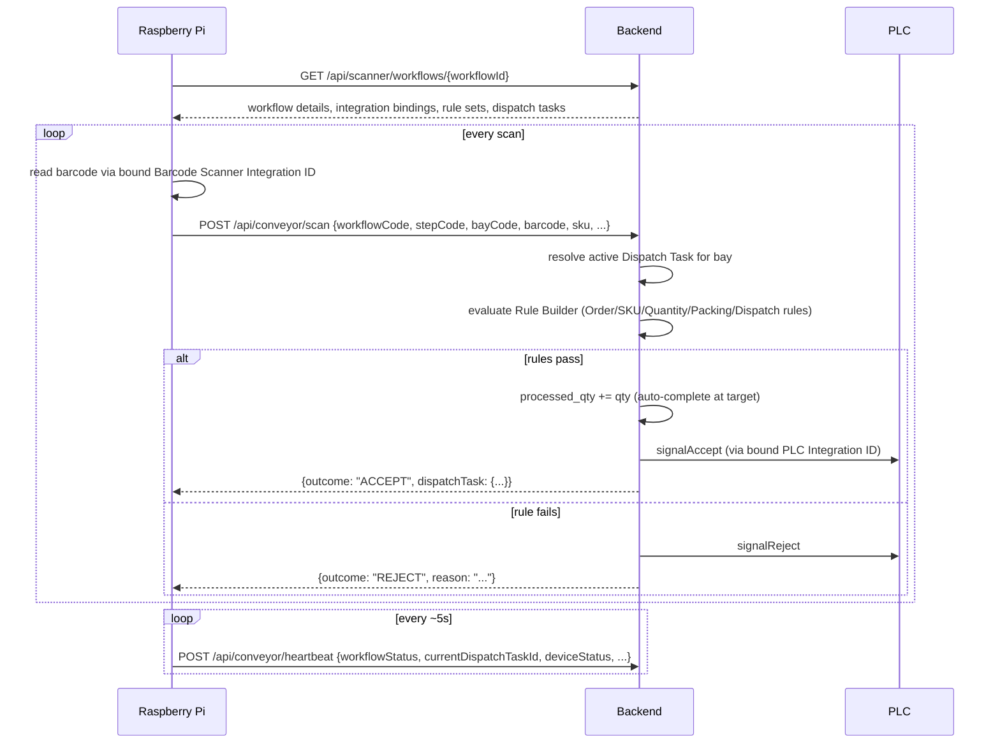

# Conveyor Scanner Workflow — Integration Guide

Backend reference for the Raspberry Pi / Python integration service driving a conveyor line: how it fetches its config, how a barcode scan is validated and answered, and exactly how dispatch-task quantity tracking and auto-completion work.

Built on the real workflow engine (`com.aria.workflow`) and the M11 Integration Hub (`com.aria.integration`) — package `com.aria.conveyor`. This is a **separate system** from the older `ConveyorAgentController` (`/api/m11/conveyor/...`, `m11_agent*` tables) — do not mix the two.

## 1. Actors

| Actor | Role |
|---|---|
| Raspberry Pi (Python) | Per conveyor line. Fetches workflow config, reads the barcode scanner, calls the backend, drives the PLC. Contains **no hardcoded line-specific logic** — everything comes from config. |
| Backend | Resolves Integration IDs, runs the Rule Builder, tracks dispatch-task quantity, tells the device ACCEPT or REJECT. |
| Barcode Scanner | An `IntegrationInstance` (any connector) bound to a workflow step with role `BARCODE_SCANNER`. |
| PLC | An `IntegrationInstance` using connector `MODBUS_TCP`, bound with role `PLC`. Receives `signalAccept`/`signalReject`. |

## 2. End-to-end flow



1. **Fetch config** — Pi calls `GET /api/scanner/workflows/{workflowId}` once (and again whenever it needs to re-sync) to learn which Integration IDs handle which role at which step, its loading bay(s), the rule sets in force, and its current dispatch task(s).
2. **Read barcode** — via the Integration ID bound to role `BARCODE_SCANNER` for the current step/bay.
3. **Submit scan** — `POST /api/conveyor/scan`. The backend, not the device, evaluates every rule — the device never runs rule logic.
4. **Accept** → dispatch task's `processed_qty` increments (auto-completing at `target_qty`), PLC gets `signalAccept`.
5. **Reject** → PLC gets `signalReject`, reason recorded.
6. **Heartbeat** — `POST /api/conveyor/heartbeat` roughly every 5 seconds regardless of scan activity.

## 3. API Reference

### 3.1 `GET /api/scanner/workflows/{workflowId}`

`{workflowId}` is the workflow **code** (string, e.g. `M12.ConveyorTest`) — the same code used everywhere else in the workflow engine, resolved tenant-fork-first then global-latest-published.

**Request:** none (just the path). No auth header — `/api/scanner/workflows/**` and `/api/conveyor/**` are permit-all, since a conveyor device has no interactive login.

**Response** (verified live example):
```json
{
  "workflowId": "M12.ConveyorTest",
  "workflowCode": "M12.ConveyorTest",
  "workflowVersion": 1,
  "workflowStatus": "PUBLISHED",
  "workflowDetails": {
    "initialState": "SCANNING",
    "transitions": [{"from": "SCANNING", "to": "DONE", "pageCode": ""}]
  },
  "integrations": [
    {"step_code": "SCANNING", "bay_code": "BAY1", "integration_role": "BARCODE_SCANNER", "integration_id": 10, "config_overrides_json": null},
    {"step_code": "SCANNING", "bay_code": "BAY1", "integration_role": "PLC", "integration_id": 11, "config_overrides_json": null}
  ],
  "loadingBays": [],
  "ruleBuilder": [
    {"id": 1, "code": "RS-TEST", "version": 1, "name": "Test Rule Set", "status": "PUBLISHED"}
  ],
  "plcIntegrations": [
    {"step_code": "SCANNING", "bay_code": "BAY1", "integration_role": "PLC", "integration_id": 11, "config_overrides_json": null}
  ],
  "dispatchTasks": [
    {"id": 1, "workflow_code": "M12.ConveyorTest", "bay_code": "BAY1", "task_code": "TASK-TEST-1",
     "order_ref": "ORDER-1", "sku_code": "SKU-1", "target_qty": 3.000, "processed_qty": 0.000,
     "rejected_qty": 0.000, "status": "IN_PROGRESS", "rule_set_id": 1, "started_at": "...", "completed_at": null}
  ]
}
```

**Field notes:**
- `integrations` — every `workflow_integration_binding` row for this workflow. `integration_id` is an `IntegrationInstance.id` — fetch its connector-specific config separately if the device needs it (e.g. barcode scanner serial config), or via `config_overrides_json` on the binding itself.
- `ruleBuilder` — rule set **metadata only** (code/name/status), never the rule expressions. Rules run exclusively on the backend.
- `dispatchTasks` — every task for the workflow, any status. Filter client-side for `status = "IN_PROGRESS"` to find what's currently active.

`404` if the workflow code doesn't resolve to a PUBLISHED definition.

### 3.2 `POST /api/conveyor/scan`

**Request:**
```json
{
  "workflowCode": "M12.ConveyorTest",
  "stepCode": "SCANNING",
  "bayCode": "BAY1",
  "barcode": "BC-001",
  "taskId": null,
  "scannerIntegrationId": 10,
  "sku": "SKU-1",
  "orderRef": "ORDER-1",
  "qty": null
}
```

| Field | Required | Notes |
|---|---|---|
| `workflowCode` | yes | |
| `bayCode` | yes | Which bay this scan happened at — used to resolve the active Dispatch Task and the PLC binding. |
| `barcode` | yes | The raw scanned value. |
| `stepCode` | recommended | Used to resolve the `PLC` integration binding for THIS step (a line can use a different PLC at different steps). |
| `taskId` | optional | Force a specific Dispatch Task. If omitted, the bay's single active task is used automatically; if several tasks are concurrently active on the bay, the one whose `sku`/`orderRef` matches wins. |
| `scannerIntegrationId` | optional | Recorded on the scan log for traceability. |
| `sku`, `orderRef` | optional | Whatever the label/scan actually encodes — fed into Rule Builder evaluation and, on accept, stamped onto the scan log. |
| `qty` | optional | Defaults to `1`. Supports multi-unit scans (e.g. a case barcode worth 12 units). |

**Response — ACCEPT** (verified live):
```json
{
  "outcome": "ACCEPT",
  "reason": null,
  "dispatchTask": {
    "id": 1, "target_qty": 3.000, "processed_qty": 1.000, "rejected_qty": 0.000,
    "status": "IN_PROGRESS", "completed_at": null, "...": "..."
  },
  "plcSignalOk": true
}
```

**Response — REJECT** (verified live, SKU mismatch):
```json
{
  "outcome": "REJECT",
  "reason": "SKU_MISMATCH",
  "dispatchTask": { "...": "unchanged except rejected_qty and updated_at" },
  "plcSignalOk": true
}
```

**Response — no active task** (e.g. task already completed, or none started):
```json
{ "outcome": "REJECT", "reason": "NO_ACTIVE_TASK", "dispatchTask": null, "plcSignalOk": null }
```

`plcSignalOk` reflects whether the bound PLC integration's `signalAccept`/`signalReject` call succeeded (`true`/`false`), or `null` if no PLC is bound for this step/bay at all.

### 3.3 `POST /api/conveyor/heartbeat`

**Request:**
```json
{
  "workflowCode": "M12.ConveyorTest",
  "deviceId": "PI-BAY1",
  "workflowStatus": "RUNNING",
  "currentDispatchTaskId": 1,
  "deviceStatus": "ONLINE",
  "lastScanAt": "2026-07-24T06:16:22Z",
  "integrationHealth": {"scanner1-test": "OK", "plc1-test": "OK"}
}
```
Send roughly every 5 seconds. `(workflowCode, deviceId)` is the upsert key. A device that stops heartbeating is automatically flipped to `device_status = "OFFLINE"` after ~15 seconds by a background sweep (`DeviceHeartbeatStalenessScheduler`).

**Response:** `{"ok": true}`

## 4. Quantity update & auto-complete

Each `dispatch_task` row tracks:

| Column | Meaning |
|---|---|
| `target_qty` | Goal quantity for this order/SKU. |
| `processed_qty` | Running total of ACCEPTED scans. |
| `rejected_qty` | Running total of REJECTED scans against this task. |
| `status` | `PENDING` → `IN_PROGRESS` → `COMPLETED` (or `CANCELLED`). |

On every **accepted** scan:
```
processed_qty += qty
if processed_qty >= target_qty:
    status = 'COMPLETED'
    completed_at = now()   # only set once
```
This is computed under a row lock (`SELECT ... FOR UPDATE`) so concurrent scans against the same task can't race each other or double-count — see `DispatchTaskService.recordAcceptedScan`.

Once `status = 'COMPLETED'`, the task no longer accepts scans — a further scan against it returns `NO_ACTIVE_TASK` (the resolver only considers `IN_PROGRESS` tasks active).

**Multiple concurrent tasks per bay** are supported natively — just multiple `dispatch_task` rows with the same `bay_code`. When more than one is active, `/api/conveyor/scan` picks the one whose `sku`/`orderRef` matches the scan; pass an explicit `taskId` to disambiguate directly.

Every scan (accepted or rejected) is appended to `dispatch_task_scan_log` for full audit history.

## 5. Rule Builder

Rules are rows in `rule_definition` (grouped into a `rule_set`), each a SpEL boolean expression evaluated against the scan context — evaluated **only on the backend** via the existing `SpelGuardEvaluator` (locked down: no reflection, no `T(...)`, no constructors).

Context variables available to a rule's `expression` (as `#submitted['key']`):

| Key | Source |
|---|---|
| `barcode` | the scanned value |
| `scannedSku`, `scannedOrderRef`, `scannedQty` | from the scan request |
| `taskSkuCode`, `taskOrderRef`, `taskTargetQty`, `taskProcessedQty`, `taskRemainingQty`, `taskStatus` | from the resolved Dispatch Task |

Example rules:
```
SKU_MATCH   (BLOCKING): #submitted['scannedSku'] == #submitted['taskSkuCode']
QTY_OK      (BLOCKING): #submitted['taskProcessedQty'] < #submitted['taskTargetQty']
```
Rules run in `sequence_no` order; the **first failing `BLOCKING`** rule wins and its `reject_reason_code` (or the guard's own denial reason if none is set) becomes the scan's `reason`. `WARNING`-severity rules never block — they're logged only. A rule whose expression itself errors (bad SpEL, missing context key) is treated as a blocking failure, never a silent pass.

Every evaluation (pass or reject) is logged to `rule_evaluation_log` with the full input context.

## 6. PLC signaling

The scan orchestration never touches a coil address directly — it just calls `signalAccept` / `signalReject` on the bound PLC `IntegrationInstance` (connector `MODBUS_TCP`). The coil mapping lives in that instance's own config:
```json
{ "acceptCoilAddress": 10, "rejectCoilAddress": 11, "pulseMs": 250, "dryRun": true }
```
`dryRun: true` (the current default — no physical PLC exists in dev) logs the pulse and returns success; flip to `false` once real hardware is wired (real Modbus TCP transport is not yet implemented — same convention as every other stub adapter in this codebase).

## 7. Data model (new tables)

| Table | Purpose |
|---|---|
| `workflow_integration_binding` | Which Integration ID handles which role at which workflow step/bay. |
| `rule_set`, `rule_definition`, `rule_evaluation_log` | Rule Builder config + audit trail. |
| `dispatch_task`, `dispatch_task_scan_log` | Target/processed quantity tracking + scan audit trail. |
| `conveyor_loading_bay` | Per-workflow bay config (not the M10 truck-dock `LoadingPoint`). |
| `device_heartbeat` | Latest heartbeat per device. |

All five are registered in `entity_registry`, so they're also manageable via the existing generic entity admin API (`/api/m0/entities/{code}`, `/api/m0/datasource/query`) with no additional frontend work.
