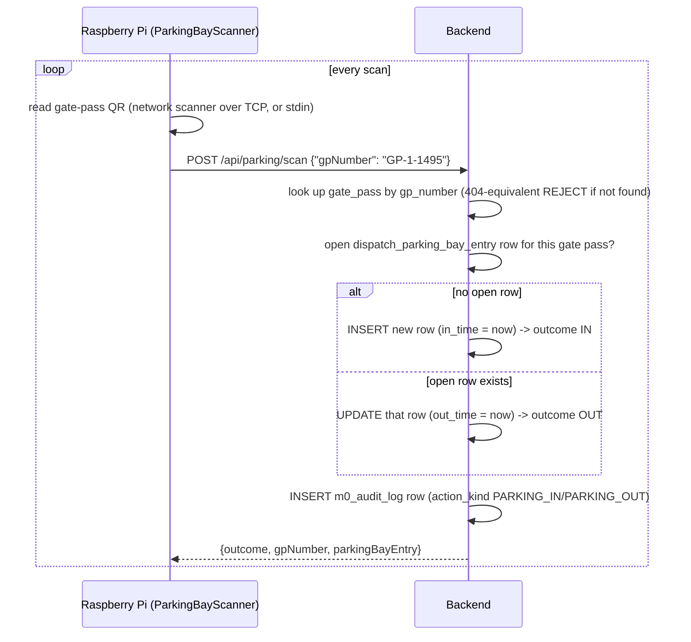

# ParkingBayScanner — Integration Guide

Backend reference for the standalone Raspberry Pi / Python device that tracks **lorry parking bay in-time and out-time only**, by scanning a gate pass QR code. This is a separate device/script from the conveyor scanner (`raspberry-pi-client/conveyor_client.py`, see `CONVEYOR_SCANNER_WORKFLOW_GUIDE.md`) — different purpose, different endpoint, no shared state — but follows the same plumbing conventions.

Reference client: [`raspberry-pi-client/parking_bay_scanner.py`](raspberry-pi-client/parking_bay_scanner.py) (config in `raspberry-pi-client/parking_bay_scanner_config.example.json`).

Companion doc: [`PARKING_BAY_SCANNER_E2E_TEST_LOG.md`](PARKING_BAY_SCANNER_E2E_TEST_LOG.md) — real, live-captured request/response pairs for every outcome (IN, OUT, REJECT) plus the resulting `m0_audit_log` rows, verified end-to-end against a running backend + dev DB. This document below covers the concepts/contract; that one is the proof it actually works as described.

## 1. What the QR encodes

A gate pass QR encodes exactly the plain `gp_number` string (e.g. `GP-1-1495`) — no URL, no JSON wrapper. See `V14__qr_slip_primitive.sql` (`qrField: 'gp_number'`) and the existing `aria:parking-scan` page's `QrScan` element. The Pi only needs to decode the QR image/scan to text and submit that text verbatim.

## 2. Flow



The device never decides IN vs OUT — it just submits the scanned `gp_number`, every time, for every lorry. The backend derives the direction from whether an open entry already exists for that gate pass: first scan opens it (IN), the next scan for the *same* gate pass closes it (OUT), and so on, alternating — same convention as the pre-existing workflow-driven `ParkingBayEntryTransitionListener`, just reachable directly by a tokenless device instead of only as a side effect of a workflow-page transition.

## 3. API Reference

### `POST /api/parking/scan`

No auth header — `/api/parking/**` is permit-all in `WebSecurityConfig`, since this device has no interactive login (same convention as `/api/conveyor/**`).

**Request:**
```json
{ "gpNumber": "GP-1-1495" }
```

**Response — IN** (no open entry existed for this gate pass):
```json
{
  "outcome": "IN",
  "reason": null,
  "gpNumber": "GP-1-1495",
  "parkingBayEntry": {
    "id": 7, "tenant_id": 1, "gate_pass_no": "GP-1-1495", "vehicle_no": "TN01AB1234",
    "flow_variant_code": "M10.TankerInbound", "loading_type": null,
    "in_time": "2026-08-03T10:15:00.000+00:00", "out_time": null,
    "created_by": null, "created_at": "2026-08-03T10:15:00.000+00:00"
  }
}
```

**Response — OUT** (an open entry existed and was just closed):
```json
{
  "outcome": "OUT",
  "reason": null,
  "gpNumber": "GP-1-1495",
  "parkingBayEntry": { "...": "same row, out_time now set" }
}
```

**Response — REJECT** (no `gate_pass` row for this `gp_number`, this tenant):
```json
{ "outcome": "REJECT", "reason": "GATE_PASS_NOT_FOUND", "gpNumber": "GP-1-1495", "parkingBayEntry": null }
```

`vehicle_no`/`flow_variant_code`/`loading_type` are resolved server-side from the `gate_pass` row by `gp_number` — the device never supplies them and they are never trusted from the client.

## 4. Data written

| Table | What |
|---|---|
| `dispatch_parking_bay_entry` | One row per parking visit. `out_time IS NULL` = currently parked (open); non-null = has left. `(tenant_id, gate_pass_no)` has a plain index, not a uniqueness constraint — multiple past visits by the same gate pass/vehicle are expected over time. |
| `m0_audit_log` | One row per scan, `action_kind` = `PARKING_IN` or `PARKING_OUT`, `entity_code` = `GatePass`, `entity_id` = the gate pass's id, plus the standard `vehicle_no`/`gp_number` denormalized columns (added V72) so it shows up in the existing Audit Tracker Group By view (`aria:audit-tracker-groupby`) without any further wiring. |

Both tables are written inside the same DB transaction (`ParkingBayScanService.scan`, `@Transactional`) — either both rows land or neither does.

**Known pre-existing bug, fixed as a side effect of this work:** `ParkingBayEntryTransitionListener` (the *other*, workflow-driven way `dispatch_parking_bay_entry` gets written, via the `aria:parking-scan` page) had always inserted `flow_variant_code`/`loading_type`, but neither column existed on the table — every IN insert through that path threw and was silently swallowed. `V212__dispatch_parking_bay_entry_missing_columns.sql` adds both columns, fixing that path too.

## 5. Setup

```bash
cd raspberry-pi-client
cp parking_bay_scanner_config.example.json parking_bay_scanner_config.json
# edit baseUrl / deviceId / scannerIp+scannerPort (or leave scannerIp unset to read from stdin)
python parking_bay_scanner.py
```

Leave `scannerIp` unset to read scanned values from stdin (dev/testing, or a USB QR scanner that enumerates as a keyboard) — type/paste a `gp_number` and press Enter per scan. Set `scannerIp`/`scannerPort` for a network (TCP/IP) scanner that streams newline-terminated decoded values.

## 6. Manual testing without a physical scanner

```bash
curl -s -X POST http://localhost:8080/api/parking/scan \
  -H 'content-type: application/json' \
  -d '{"gpNumber":"GP-1-1495"}'
# -> outcome IN (first call for this gp_number)

curl -s -X POST http://localhost:8080/api/parking/scan \
  -H 'content-type: application/json' \
  -d '{"gpNumber":"GP-1-1495"}'
# -> outcome OUT (second call closes the entry opened above)
```
Use a real `gp_number` from an existing `gate_pass` row in your dev DB (`SELECT gp_number FROM gate_pass LIMIT 5`) — an unknown one returns `REJECT`/`GATE_PASS_NOT_FOUND`.
